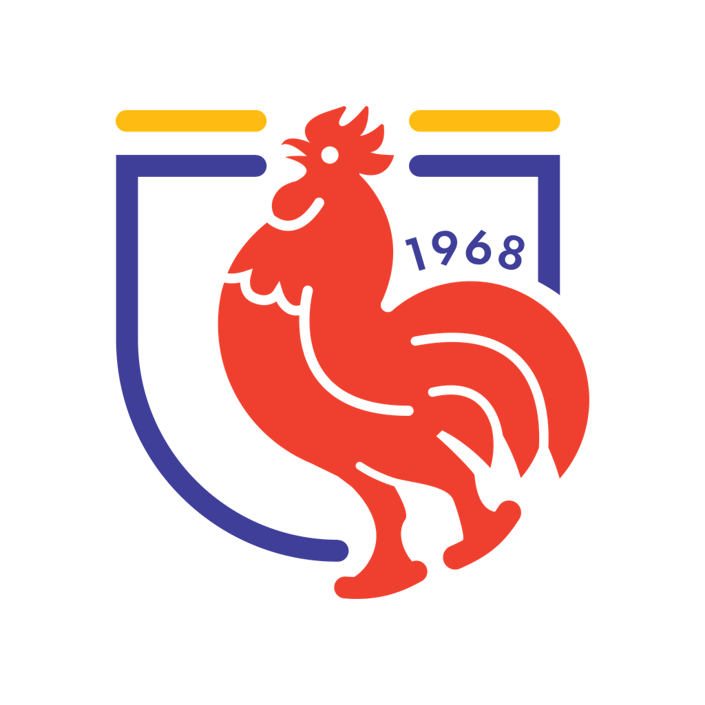

  

<h3 align="center">Liceo Franco-Costarricense · Lycée Franco-Costaricien</h3>

  <a href="https://franco.ed.cr">franco.ed.cr</a>

**ES** — Espacio de código institucional del Liceo Franco-Costarricense: aplicaciones propias y proyectos técnicos del liceo. La mayor parte del trabajo es privado; aquí se publica lo que el liceo decide compartir.

Integrantes del Comité Ejecutivo de la AFCE: material de incorporación en [`comite-ejecutivo/`](https://github.com/LiceoFrancoCostarricense/.github/tree/main/comite-ejecutivo).

**FR** — Espace de code institutionnel du Lycée Franco-Costaricien : applications propres et projets techniques de l'établissement. L'essentiel du travail est privé ; nous publions ici ce que le lycée choisit de partager.
